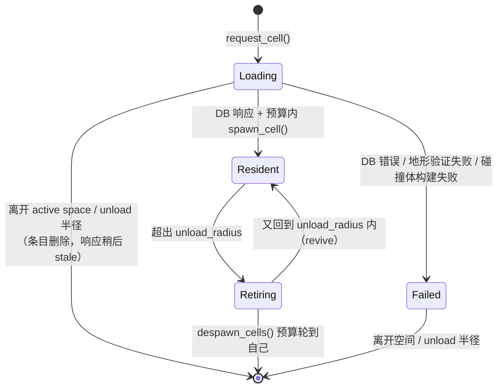

# Chunk streaming：玩家移动如何触发资产加载与渲染

> 适用代码：`main` @ `0c7ad810`（2026-10-25）。
>
> 本文讲**运行时**的 cell / LOD chunk 流式加载。转换器如何离线生成地形 LOD 不在本文范围，见
> [`docs/specs/converters/lod-compiler.md`](../specs/converters/lod-compiler.md)。
>
> 相关设计文档：
> [`lod-architecture.md`](../specs/engine/lod-architecture.md)、
> [`merged-terrain.md`](../specs/engine/merged-terrain.md)、
> [`adaptive-streaming.md`](../research/adaptive-streaming.md)。

---

## 0. 一句话结论

玩家移动时，引擎**不会**“每帧检查并加载附近所有东西”。

实际链路是：

1. 玩家/相机的位置在 `Update` 中先更新；
2. `StreamingPlugin` 的系统链随后运行，把相机位置换算成 **cell 网格坐标**；
3. `plan_cells` 只对**当前想要、但还没有请求过**的 cell 发请求；
4. SQLite 后台线程异步查询 cell 的 references；
5. `collect_cells` 在主线程按预算接收响应，校验 generation，然后 `spawn_cell` 建实体；
6. 每个 reference 的模型由 `AssetServer` 异步加载，加载完成后由 `arm_pending_models`
   分批交给 Bevy 的 scene spawner；
7. 地形 LOD chunk 走另一条并行的 key space `(world, tier, anchor)`，和 cell 共用每帧提交预算；
8. 资产真正可绘制后，材质/贴图/网格/可见性才被放行；LOD 地形则在“完整 cell 已 drawable”后隐藏。

所以“移动触发加载”的本质是：

> **相机跨 cell → 想要的 cell 集合变化 → 对差集发请求 → 异步取数据 → 分批提交到 ECS →
> 资产加载完成后分批实例化 → 可见性系统决定画完整地形还是 LOD 地形。**

---

## 1. 全局架构

```mermaid
flowchart LR
    Input[WASD / 鼠标 / 传送 / 门] --> Move[FixedUpdate: 角色移动<br/>或 Update: 自由相机]
    Move --> Cam[StreamingCamera Transform]
    Cam --> Chain[StreamingPlugin 系统链<br/>after PlayerControlsSystems]

    Chain --> Plan[plan_cells<br/>计算 wanted cells]
    Plan -->|差集请求| DB[(SQLite worker<br/>mudcrab-world-db)]
    DB -->|CellPayload| Collect[collect_cells]
    Collect --> Spawn[spawn_cell<br/>CellRoot / Terrain / References]

    Spawn --> SceneReq[SceneRequest / PendingModel]
    SceneReq --> AssetServer[AssetServer<br/>GLB scene 异步加载]
    AssetServer --> Arm[arm_pending_models<br/>预算内交给 WorldAssetRoot]
    Arm --> SpawnScene[Bevy SpawnScene<br/>WorldInstanceSpawn]
    SpawnScene --> ECS[场景实体 / Mesh3d / 材质]
    ECS --> Render[Bevy 渲染提取]

    Chain --> LodPlan[plan_lod_chunks]
    LodPlan -->|LodChunkQuery| DB
    DB -->|LodChunkMetadata| LodCollect[collect_lod_chunks]
    LodCollect --> LodAsset[GLB chunk 异步加载<br/>SHA-256 校验]
    LodAsset --> LodReady[track_lod_readiness]
    LodReady --> Visibility[update_terrain_lod_visibility]
    Visibility --> Render

    Chain --> Rebase[update_render_origin<br/>原点重定]
    Rebase --> Cam
```



关键点：

- **cell** 是 gameplay/完整细节的单位，通常是 Skyrim 的一个 exterior cell 或一个 interior cell。
- **LOD chunk** 是远景地形的单位，按 `4 / 8 / 16` cell 的固定块划分。
- 两者有各自的 key space，但**共用同一个每帧提交预算**，让 cell 和 LOD 都能推进，而不是一方
  永远抢不到预算。
- 资产加载与渲染都在主世界/渲染世界的常规 Bevy 管线里完成，streaming 不直接画东西，它只负责
  “什么时候把什么实体/资产放进来”。

---

## 2. 先理解几个坐标与 key

### 2.1 `CELL_SIZE = 4096`

`crates/engine/src/world/components.rs`：

```rust
pub const CELL_SIZE: f32 = 4096.0;
```

Skyrim 的一个 exterior cell 是 4096 Creation units 宽。

### 2.2 `CellKey`

`crates/engine/src/world/database.rs`：

```rust
pub enum CellKey {
    Exterior { worldspace_id: u32, grid_x: i32, grid_y: i32 },
    Interior(u32),
}
```

- Exterior 用 `(worldspace_id, grid_x, grid_y)` 唯一标识。
- Interior 直接用它自己的 cell id。

### 2.3 渲染原点 `RenderOrigin`

`crates/engine/src/streaming.rs`：

```rust
pub struct RenderOrigin(pub IVec2);
```

引擎不把整个世界放在巨大的世界坐标里，而是让实体坐标相对一个**整数 cell 原点**。启动时：

```rust
let origin = RenderOrigin(IVec2::new(config.start_grid.0, config.start_grid.1));
```

之后玩家走远了，`update_render_origin` 会把原点按整 cell 平移，实体坐标随之回移。
这样 f32 精度不会随着玩家走了几十万单位而崩坏。

### 2.4 相机全局位置 → cell 网格

`streaming_center`（`crates/engine/src/streaming.rs`）：

```rust
let global_x = translation.x + origin.x as f32 * CELL_SIZE;
let global_y = -translation.z + origin.y as f32 * CELL_SIZE;
IVec2::new(
    (global_x / CELL_SIZE).floor() as i32,
    (global_y / CELL_SIZE).floor() as i32,
)
```

注意两点：

1. **Y 轴翻转**：Creation 的 `y` 对应 Bevy 的 `-z`。
2. 用的是 `floor`，所以负坐标会正确落到更小的 cell（例如 `-1..0` 属于 `-1`）。

### 2.5 cell root 的局部平移

`cell_translation`：

```rust
Vec3::new(
    (grid_x - origin.x) as f32 * CELL_SIZE,
    0.0,
    -(grid_y - origin.y) as f32 * CELL_SIZE,
)
```

所以一个 cell 的根实体总是位于“相对当前原点的整数格”上。origin 重定后，只需要改 root
的 `Transform`，不需要重建它。

### 2.6 LOD chunk key

`crates/shared/src/lod.rs`：

```text
ChunkKey = (worldspace_id, tier, anchor)
tier     = 4 / 8 / 16 cells
```

chunk 路径：

```text
lod/<world:08x>/<side>/cell_<anchor_x>_<anchor_y>.glb
# <side> = 4 / 8 / 16；<anchor_*> 是 chunk 网格坐标，可为负
```

一个 chunk 覆盖 `side × side` 个 cell 的方块；anchor 是该方块在 tier 网格上的整数坐标。
一个 chunk 里可以包含多个源 cell 的地形节点，但**不是**“每个 object 一个 LOD 资产”。

---

## 3. 每帧系统链

`StreamingPlugin::build`（`crates/engine/src/streaming.rs`）把系统按顺序串起来，并明确排在
`PlayerControlsSystems` 之后：

```rust
.add_systems(
    Update,
    (
        runtime::update_streaming_control,
        plan_cells,
        despawn_cells,
        lod::plan_lod_chunks,
        collect_cells,
        lod::collect_lod_chunks,
        requests::dispatch_scene_requests,
        arm_pending_models,
        track_asset_readiness,
        track_surface_readiness,
        track_merged_surface_readiness,
        lod::track_lod_readiness,
        lod::batch_ready_lod_chunks,
        lod::update_terrain_lod_visibility,
        finish_streaming_commit_budget,
        update_render_origin,
        validate_streaming_lifecycle,
        runtime::observe_streaming_ownership,
    )
        .chain()
        .after(PlayerControlsSystems),
)
```

| 顺序 | 系统 | 作用 |
|---:|---|---|
| 1 | `update_streaming_control` | 只有启用自适应控制时才工作：采样移动/队列/内存，算出本帧预算 |
| 2 | `plan_cells` | 设置预算，计算 wanted cell 集合，对差集发 cell 请求，处理 retain/revive/retire |
| 3 | `despawn_cells` | 独占系统，按预算真正 despawn `Retiring` 的 cell 子树 |
| 4 | `plan_lod_chunks` | 更新 LOD 中心/generation，按 tier 发范围查询，保留/卸载 chunk，给 LOD 预留预算 |
| 5 | `collect_cells` | 收 DB 响应，拒绝 stale，处理 merged terrain 的 hold，按预算 commit + `spawn_cell` |
| 6 | `collect_lod_chunks` | 收 LOD 查询响应，扩展相机远平面；把 metadata 入队，并在剩余预算内创建/请求 chunk |
| 7 | `dispatch_scene_requests` | 仅在 scene admission 开启时：共享场景加载、优先级、内存预留 |
| 8 | `arm_pending_models` | 把已经加载完成的模型按预算交给 `WorldAssetRoot` |
| 9 | `track_asset_readiness` | 验证已实例化的模型场景，建立静态碰撞，失败时隐藏 |
| 10 | `track_surface_readiness` | 验证地形 quadrant / 水的材质与贴图，放行可见性和碰撞体 |
| 11 | `track_merged_surface_readiness` | 合并地形不需要等贴图，直接放行 |
| 12 | `lod::track_lod_readiness` | LOD chunk 的 hash、加载、场景结构验证，标记 ready |
| 13 | `lod::batch_ready_lod_chunks` | 可选的 LOD 地形合批提交（受同一预算约束） |
| 14 | `lod::update_terrain_lod_visibility` | 每个 quadrant 选择画哪一级 LOD |
| 15 | `finish_streaming_commit_budget` | 记录本帧 commit 时间、是否超预算 |
| 16 | `update_render_origin` | 相机跨过一个 cell 时重定原点，平移实体和 Rapier body |
| 17 | `validate_streaming_lifecycle` | 断言/统计生命周期不变量（孤儿 root、pending 数等） |
| 18 | `observe_streaming_ownership` | 把场景/资源所有权纳入 runtime 的账本 |

另外，`SpawnScene` 调度里还有两个只用于计量的系统：

```rust
begin_scene_spawn_batch.before(SceneSpawnerSystems::WorldInstanceSpawn)
end_scene_spawn_batch.after(SceneSpawnerSystems::WorldInstanceSpawn)
```

Bevy 的 `WorldInstanceSpawn` 会在一帧里实例化**所有**已就绪的 `WorldAssetRoot`。这两个系统
只负责把这一批实例化的成本记到 profiling 里；真正限制批量大小的是第 8 步
`arm_pending_models`。

---

## 4. 玩家移动到底怎么被感知

### 4.1 两种移动路径

**A. 交互式角色（默认窗口运行）**

`PlayerControlsPlugin`（`crates/engine/src/physics.rs`）注册：

- `FixedUpdate`：
  - `release_walk_spawn_hold`
  - `walk_movement_system`
- `Update`：
  - `look_input_system`
  - `noclip_flight_system`
  - `walk_intent_system`
  - `walk_camera_follow_system`
  - 其他输入/UI 系统

`walk_movement_system` 把输入积分成 `KinematicCharacterController.translation`，Rapier 在
`FixedUpdate` 的物理步里移动 `PlayerBody`。本仓库用的是 `bevy_rapier3d 0.36.0`（Rapier 3D），
不是 Avian 或 Havok。`walk_camera_follow_system` 在 `Update` 里把
`StreamingCamera` 放到角色眼睛高度：

```rust
view.translation = body.translation + Vec3::Y * tuning.eye_height;
```

因此相机的位置是“角色 body 位置 + 眼高”，streaming 读的是相机 `Transform`。

**B. 自由相机 / benchmark / 截图**

`fly_camera`（`crates/engine/src/app.rs`）在 `Update` 里直接修改
`StreamingCamera` 的 `Transform`：

- `W/A/S/D` 平移，`Space/Shift` 升降；
- 默认速度 `900`，按住 `Ctrl` 为 `4000`；
- `auto_fly_speed > 0` 时还会叠加自动飞行方向。

自由相机只在非交互运行中启用（`interactive_world_physics()` 为 false 等条件）。

### 4.2 为什么 streaming 排在 `PlayerControlsSystems` 之后

因为 streaming 需要读**本帧最新的相机位置**，而不是上一帧的。

`StreamingPlugin` 的链式系统全部 `after(PlayerControlsSystems)`，所以：

1. `FixedUpdate` 移动 body；
2. `Update` 的相机跟随/自由相机更新 `Transform`；
3. `Update` 的 streaming 链读到新位置。

这里读的是 `Transform`，不是 `GlobalTransform`。`GlobalTransform` 要到 `PostUpdate` 才传播，
会晚一帧；streaming 和 fly lag 统计都刻意使用 `Transform` 来避免这个延迟。

### 4.3 移动并不直接“加载”

`plan_cells` 不会每帧重新加载所有 cell。它做的是：

```text
当前 wanted 集合
  - 已经在 cells 表里的 key（Loading / Resident / Retiring / Failed）
  - 已经 outstanding 的 key
  = 本帧要新请求的 key
```

所以：

- 玩家在同一个 cell 内移动：**不产生新的 cell 请求**；
- 跨过一个 cell 边界：通常只新增一列/一行 cell（半径 2 时 5 个；斜向跨两个轴则 9 个）；
- 快速飞行：每帧可能跨多个 cell，请求差集变大，但 commit 仍然受预算限制；
- 原点重定：**不产生新请求**，因为全局 cell 坐标没变。

---

## 5. Cell streaming 的完整生命周期

### 5.1 `ActiveSpace`：到底在流哪个空间

`ActiveSpace`：

```rust
pub struct ActiveSpace {
    pub worldspace_id: Option<u32>, // None = 使用配置的 worldspace
    pub interior: Option<u32>,      // Some(cell_id) = 玩家在 interior
}
```

正常 exterior：

```text
wanted_cells = (2r + 1)² 个 exterior cell
```

默认 `stream_radius = 2`，所以 wanted 是 `5 × 5 = 25` 个 cell。

进入 interior 后：

```text
wanted_cells = { CellKey::Interior(cell_id) }
```

即**只流当前 interior 一个 cell**，不再保留 exterior 窗口。

`ActiveSpace` 只由 load door 跨越修改（`crate::door_crossing`），其他系统不会随便改它。

### 5.2 wanted、retain、revive、retire

`plan_cells` 的核心：

```text
1. 计算 center = window_center(camera, origin)
2. wanted = wanted_cells(space, worldspace, center, stream_radius)
3. 对 wanted 里尚未存在的 key 调 request_cell
4. retain 现有 cells：
   - 仍在 active space 且在 unload_radius 内：
       - Resident 继续 Resident
       - Retiring 变回 Resident（revive，保留原 root）
   - 不在 active space 或超出 unload_radius：
       - Resident -> Retiring（等待 despawn 预算）
       - Retiring 继续等待
       - Loading/Failed -> 直接删除条目（在途响应之后变 stale）
```

默认：

| 参数 | 值 | 含义 |
|---|---:|---|
| `stream_radius` | 2 | 想要 5×5 |
| `unload_radius` | 3 | 离开 7×7 才 retire |

这两个值之间的环就是**滞后区**：

- 刚超出 `unload_radius` 的 cell 变成 `Retiring`，但**仍然绘制**；
- 如果玩家在它被 despawn 前又走回来，`Retiring -> Resident`，不会重新请求、不会闪一下；
- 这样在 cell 边界来回走不会反复 load/unload。

注意：`--stream-radius N` 会把 `unload_radius` 自动设为 `N + 1`（`config.rs`）。
代码里 `unload_radius` 也可以被单独配置，但常规 CLI 是联动。

### 5.3 `CellStatus` 状态机



关键语义：

- `Resident` 只表示“root 已经 spawn”，**不代表**所有模型/贴图都已加载完成。
- `Failed` 不会自动重试；该 cell 在本次驻留期间保持失败，直到它离开窗口。
- `Retiring` 仍然在 `StreamingWorld.cells` 里，所以 `request_cell` 不会重复请求它；
  revive 时直接复用 root。

### 5.4 请求：`request_cell`

```rust
pub(crate) fn request_cell(
    &mut self,
    database: &WorldDatabase,
    key: CellKey,
    metrics: &mut StreamingMetrics,
    profiler: &mut ProfilingState,
) -> bool
```

行为：

1. 如果 `cells` 或 `outstanding_cells` 已有这个 key，返回 `false`（不重复请求）。
2. `generation += 1`，得到本次 load 的 generation。
3. `database.try_request(DatabaseRequest::Load { generation, key, queued_at })`。
4. 成功则：
   - `metrics.requests_submitted += 1`
   - `cells.insert(key, Loading { generation })`
   - `outstanding_cells.insert(key, generation)`

`outstanding_cells` 的作用是：即使 cell 已经从 `cells` 里被删掉（例如离开窗口），
只要响应还没被消费，仍然记得它，避免重复请求/重复计数。

### 5.5 DB 后台线程

`WorldDatabase::open`（`crates/engine/src/world/database.rs`）：

```rust
let (request_tx, request_rx) = bounded(128);
let (response_tx, response_rx) = unbounded();
let (lod_response_tx, lod_response_rx) = unbounded();
thread::Builder::new()
    .name("mudcrab-world-db".into())
    .spawn(move || {
        worker(path, request_rx, response_tx, lod_response_tx);
    })
```

特点：

- **请求通道有界 128**：主线程 `try_send`，满了就失败，下一帧再试。
- **响应通道无界**：worker 不会因为主线程没空收而阻塞；主线程按预算慢慢消费。
- **单线程、只读 SQLite**：`SQLITE_OPEN_READ_ONLY | SQLITE_OPEN_NO_MUTEX`。
- cell 响应和 LOD 响应走**两个独立通道**，互不阻塞。

cell 查询：

```sql
-- 先按 worldspace/grid 找 cell id；优先有 land 的，再取 id 最大的
SELECT c.id FROM cells c
LEFT JOIN land l ON l.cell_id=c.id
WHERE c.worldspace_id=?1 AND c.grid_x=?2 AND c.grid_y=?3
ORDER BY (l.cell_id IS NOT NULL) DESC, c.id DESC
LIMIT 1

-- exterior references：走 exterior_spatial R-tree
SELECT ... FROM exterior_spatial x
JOIN "references" r ON r.id=x.id
WHERE x.worldspace_id=?1
  AND x.minX>=?2 AND x.minX<?3
  AND x.minY>=?4 AND x.minY<?5

-- interior references：直接按 cell_id
SELECT ... FROM "references" r WHERE r.cell_id=?1
```

除几何/模型外，worker 还会解析：

- `initially_enabled`：通过 `EnableStateResolver` 解析 enable parent 链；
- 灯光、emittance、door link 等扩展行（如果 DB 有这些表/列）。

返回的 `CellPayload`：

```rust
pub struct CellPayload {
    pub generation: u64,
    pub key: CellKey,
    pub cell_id: u32,
    pub references: Vec<ReferenceRow>,
}
```

### 5.6 响应收集：`collect_cells`

`collect_cells` 是主线程上的“收件 + 提交”系统，顺序很关键：

```text
for 最多 response_scan_limit 次:
    1. 若 merged terrain 正在 hold：新到的带地形响应会被移进 held_responses；
       不 hold 时，held 会先于新响应回放
    2. 从 runtime.deferred_responses 或 database.try_response() 取一个
    3. 统计 query/queue/request 时间
    4. 检查 generation：不是当前 Loading 的 generation -> stale，丢弃
    5. merged terrain 需要 hold 的响应 -> 放回 held_responses
    6. 再次检查 CellStatus::Loading { generation }
    7. 内存预留（runtime 开启时）：
         失败 -> deferred_responses，稍后重试
    8. consume outstanding
    9. budget.remaining -= 1; commits += 1
   10. spawn_cell(...)
```

`response_scan_limit`：

```rust
let response_scan_limit = config.max_cell_commits_per_frame.saturating_mul(8).max(8);
```

默认 `max_cell_commits_per_frame = 1`，所以每帧最多**扫描 8 个响应**，但只 commit 1 个。
多扫描的意义是：把 stale 响应快速清掉，把需要 hold 的响应移出 DB 队列，不让它们堵住后面的
有效响应。

#### 为什么会有两处 generation 检查

- 第一次检查：响应可能对应一个已经被删除的 cell（离开窗口）；
- 第二次检查：`CellStatus` 可能已经从 `Loading` 变成别的东西；
- 即使 key 还在，generation 也可能因为“离开又重新请求”而不同。

两者任一不匹配，都：

```rust
streaming.consume_cell_response(key, generation);
metrics.stale_responses += 1;
```

然后 `continue`，**不占 commit 预算**。

#### merged terrain 的 hold

如果转换产物包含 merged terrain 数据，`TerrainMerge` 在启动时加载：

- `terrain/land-textures.json`
- `terrain/land-*.ktx2` 纹理数组
- `terrain/<world>/chunk_*.rkyv` 地形 chunk

在这些数组 ready 或 refused 之前，`collect_cells` 会把**带地形**的 exterior cell 响应
放入 `held_responses`，按到达顺序排队；等 setup 结束后再优先回放。

原因：不能让一个 cell 因为数组晚到而被迫走 quadrant 路径，否则同一 worldspace 里会混用
两种地形路径，接缝和性能都不一致。

- interior、没有 LAND 的 cell、加载失败的 cell：不 hold，直接提交。
- hold 的响应如果变 stale：立即丢弃并释放 outstanding。
- setup 最多等 `terrain_merge::SETUP_TIMEOUT`（120 秒），超时按 refused 处理，回放所有 held。

#### 提交预算

`StreamingCommitBudget` 同时被 cell 和 LOD 使用：

```rust
struct StreamingCommitBudget {
    frame_started: Instant,
    remaining: usize,
    commits: usize,
    lod_priority: bool,
    reserved_for_lod: bool,
    prefer_deferred_response: bool,
}
```

默认：

```text
remaining = max_cell_commits_per_frame = 1
```

`collect_cells` 用 `remaining_for_cells()`：

```rust
fn remaining_for_cells(&self) -> usize {
    self.remaining
        .saturating_sub(usize::from(self.reserved_for_lod))
}
```

也就是说，如果 LOD 有排队工作并且本帧轮到 LOD，cell 会让出 1 个名额。

`collect_cells` 每 commit 一个 cell：

```rust
commit_budget.remaining -= 1;
commit_budget.commits += 1;
```

然后 `spawn_cell`。如果 `spawn_cell` 失败（例如地形 trimesh 构建失败），cell 变为
`Failed`，但预算已经花掉。

### 5.7 `spawn_cell` 到底建了什么

`spawn_cell`（`crates/engine/src/streaming.rs`）创建一个 cell 根，然后按顺序挂载：

```text
Cell <cell_id>                 (StreamedCellRoot, CellRef, Transform, Visibility)
├── Terrain cell / quadrant 0..3
│   ├── Mesh3d + TerrainMaterial
│   ├── TerrainCollider + RigidBody::Fixed + ColliderDisabled
│   └── SwapSurface / SwapWaiting（用于渲染世界确认）
├── Water surface
├── Reference <form_id>
│   ├── Transform / WorldPosition / WorldTransform
│   ├── SceneRequest 或 PendingModel + PendingAssetProfile
│   ├── Light
│   └── Door
└── ...
```

#### 地形：merged 还是 quadrant

对每个 exterior cell：

1. `cache.terrain(payload.cell_id)` 从 `cell_cache.rkyv` 读取 `TerrainSnapshot`；
2. `choose_merged_terrain` 尝试 merged 数据：
   - `TerrainMerge::lookup` 找到 cell；
   - `merged_geometry_check` 验证 seam duplicate、法线非零；
   - 有 classes/material/images -> 返回 `MergedSpawn`；
   - `NoData` / `Invalid` / `Unavailable` -> 计数 fallback，走 quadrant。
3. merged：
   - `build_merged_mesh` 生成**一个** mesh；
   - 从同一份 buffers 生成**一个** trimesh collider；
   - 一个 `TerrainPatch`，隐藏 + `SwapWaiting`。
4. quadrant：
   - 生成 4 个 quadrant mesh；
   - 每个 quadrant 一个 trimesh collider；
   - 每个 quadrant 一个 `TerrainPatch`，隐藏 + `PendingTerrainProfile` + `SwapWaiting`。

地形网格和碰撞体是**同一份顶点/索引**构建的，所以视觉和碰撞完全一致。

#### 地形接缝

`settle_cell_terrain` 会走 `validate_and_register_terrain_edges`：

- 新 cell 与已驻留邻居共享边的高度必须能接上；
- 差值在允许范围内会 weld；
- 差太多则按 authored 保留并计数（例如城市地形与未雕刻的野外接壤）。

这保证了 cell 逐个到达时不会出现高度裂缝。

#### Reference

对每个 `initially_enabled` 的 reference：

1. 位置从 Creation 坐标转成 Bevy：
   - `WorldPosition::from_creation_units`
   - exterior 相对 cell 原点，interior 绝对坐标；
   - `creation_to_bevy` 做轴转换。
2. 旋转、缩放、bounds；
3. Actor catalog 命中时生成 actor plan（身体/头/皮肤/动画）；
4. spawn reference 实体，挂：
   - `FormId`、`CellRef`、`WorldPosition`、`WorldTransform`
   - `Propagate(PLACED_OBJECT_RENDER_LAYERS)`
   - `InstanceBounds` / `ExpectedModelBounds`
   - 灯光、door、emittance 等
5. 有模型路径时：
   - 默认模式：直接 `asset_server.load(GltfAssetLabel::Scene(0).from_asset(path))`，
     插入 `PendingModel { handle, sequence }`；
   - admission 模式：插入 `SceneRequest { ... }`，稍后由 `dispatch_scene_requests` 处理；
   - 无论哪种，都插入 `PendingAssetProfile`，供 readiness 扫描验证。

#### 为什么 reference 是 cell root 的子实体

因为：

- cell unload 时，`despawn_subtree(cell_root)` 会一次性带走所有 reference、模型场景、灯光、门；
- origin 重定时，cell root 的 `Transform` 移动，所有子实体跟着移动；
- 不需要为模型单独维护“卸载队列”。

---

## 6. 模型资产：从 DB 到屏幕

### 6.1 两条路径：默认 vs scene admission

`requests::enabled(config)`：

```rust
config.prioritize_streaming
    || config.max_scene_loads != 0
    || config.streaming_controls_enabled()
```

默认配置三者都关，所以**默认不走 admission**。

| 模式 | 触发条件 | 行为 |
|---|---|---|
| 默认 | 三个开关都关 | `spawn_cell` 直接 `AssetServer::load`，每个 reference 一个 `PendingModel` |
| admission | `--prioritize-streaming` / `--max-scene-loads N` / `--adaptive-streaming` 等 | `spawn_cell` 只插 `SceneRequest`，由 `SceneAdmission` 共享/调度加载 |

默认路径也仍然有 `arm_pending_models` 的 32 个/帧预算；admission 只是把“加载请求”也纳入
优先级、共享和内存预留。

### 6.2 admission 的共享加载

`SceneAdmission` 把场景请求归一化成 `SceneKey`：

```text
SceneKey {
    canonical_path,
    build_identity: Option<String>,   // conversion-manifest.json 的 SHA-256 + pack 根路径
    content_identity: Option<String>, // LOD chunk 用 payload hash；普通模型通常为 None
}
```

因此同一个 GLB 被多个 reference 引用时：

- 只会有一个 `AssetServer::load`；
- 所有 `SceneRequest` 共享同一个强 handle；
- `dispatch_scene_requests` 把 handle fan-out 给每个 demand，并各自插入 `PendingModel`。

优先级（`crates/engine/src/streaming/priority.rs`）：

1. `protected_collision`：距相机表面 1 个 cell 内的碰撞候选，优先；
2. `coarse_terrain`：LOD 地形走单独 lane，不挤占近处细节模型；
3. `view_facing`：在相机前半球（按包围球扩展）优先；
4. `projected_radius`：屏幕投影更大的优先；
5. `surface_distance`：更近的优先；
6. `sequence`：更老的优先。

此外每 8 次选择会走一次 **aged lane**，避免低优先级任务永远饿死。

### 6.3 `arm_pending_models`：真正的实例化闸门

`PendingModel` 只是“我知道这个模型该加载，handle 在这里”。它还不是实体场景。

`arm_pending_models` 每帧：

1. 收集所有 `PendingModel`；
2. 过滤 `model_can_spawn`：
   ```rust
   world_assets.contains(handle.id())
       || matches!(
           asset_server.get_load_states(handle.id()).map(|(load, _, _)| load),
           Some(LoadState::Failed(_))
       )
   ```
   即：**场景资产已经进 `Assets<WorldAsset>`，或者已经失败**。
   失败也 arm，是为了让 readiness 能报告失败，而不是让 reference 永远 pending。
3. 预算：
   ```rust
   budget = decision.map_or(config.max_model_spawns_per_frame, |decision| {
       decision.budgets.max_model_activations
   });
   ```
   默认 32；`0` 且无 controller 时表示不限。
4. 默认按 `sequence` 从老到新；`--prioritize-streaming` 时按 priority 重排。
5. 对选中的实体插入：
   ```rust
   WorldAssetRoot(handle)
   ```
   并移除 `PendingModel`。

一旦插入 `WorldAssetRoot`，Bevy 的 `SpawnScene` 调度就会在
`SceneSpawnerSystems::WorldInstanceSpawn` 里实例化它。这个 pass 本身是**不按模型逐个限流**的，
所以 `arm_pending_models` 的 32 就是实际控制“这一帧最多实例化多少模型”的地方。

### 6.4 `WorldInstanceReady` 与 readiness

`mark_world_instance_ready` 是 observer：

```rust
fn mark_world_instance_ready(
    ready: On<WorldInstanceReady>,
    mut pending: Query<&mut PendingAssetProfile>,
) {
    pending.scene_spawned = true;
}
```

`track_asset_readiness` 随后扫描所有带 `PendingAssetProfile` 且已经 `WorldAssetRoot` 的实体：

- 场景是否加载完成（load + recursive dependencies）；
- transform / bounds / primitive / material 是否有效；
- 符合固定碰撞条件的 reference 是否建立静态碰撞体；
- 成功：移除 `PendingAssetProfile`，计入完成；
- 失败：`hide_partial_scene` 隐藏已经实例化的部分，记录 `AssetFailure`，
  可选生成 diagnostic fallback。

注意：模型场景在 `WorldInstanceSpawn` 实例化后**通常已经可见**，readiness 是在之后做验证；
只有验证失败才会被隐藏。它不是“验证通过才显示”的闸门。

### 6.5 完整的模型时序

```mermaid
sequenceDiagram
    participant S as spawn_cell
    participant A as AssetServer
    participant P as PendingModel
    participant Arm as arm_pending_models
    participant SS as SpawnScene
    participant R as track_asset_readiness

    S->>A: load(Scene(0), path) 或 SceneRequest
    A-->>S: Handle&lt;WorldAsset&gt;
    S->>P: PendingModel { handle, sequence }
    loop 每帧
        Arm->>P: 查询 ready 的 PendingModel
        Arm->>A: model_can_spawn? (Assets 或 Failed)
        Arm->>SS: 插入 WorldAssetRoot(handle)
        SS->>SS: WorldInstanceSpawn 实例化场景
        SS-->>R: WorldInstanceReady observer
        R->>R: 验证 transform/bounds/collision
    end
```

---

## 7. 地形 LOD streaming

### 7.1 为什么需要单独的 LOD 流

完整 cell 只覆盖 `5×5`（默认）的近距离。再远的地方如果也按完整 cell 加载，代价会爆炸。

所以引擎在完整 cell 网格之外，再流一套**远景地形 LOD**：

- tier 4：4×4 cell 一块；
- tier 8：8×8 cell 一块；
- tier 16：16×16 cell 一块。

每一级有自己的可见距离：

```text
reach_cells(tier) = floor(block_distance * fSplitDistanceMult / 4096)
```

默认（Skyrim SE `SkyrimPrefs.ini`）：

| tier | block distance | reach |
|---|---:|---:|
| 4 | 35,000 | 12 cells |
| 8 | 70,000 | 25 cells |
| 16 | 250,000 | 91 cells |

### 7.2 什么时候发 LOD 查询

`plan_lod_chunks` 每帧：

1. 从 `ActiveSpace` 决定 `lod_worldspace`：
   - `stream_radius < 0` -> LOD 关闭；
   - interior -> 不流 LOD；
   - 否则使用当前 exterior worldspace。
2. 计算 LOD 中心 `streaming_center(...)`。
3. 如果中心、worldspace 或地形距离配置变了：
   ```rust
   streaming.move_center(center, worldspace_id, &config.terrain_lod);
   ```
4. 对每个 tier，如果 `query_ready(tier)`：
   - 以 `center ± (reach + 2)` 为世界 bounds 发 `LodChunkQuery`；
   - `+2` 是 `LOD_UNLOAD_MARGIN_CELLS`，用于滞后。
5. 保留仍在自己 tier 的 `reach + 2` 内的 resident chunk；
   范围外的立即 despawn。
6. 把 pending chunk 队列里不属于当前 generation 的丢掉；
7. `budget.reserve_for_lod(...)` 给 LOD 预留提交名额。

`query_ready` 的含义：

- `requested_queries` 里没有这个 tier（本中心尚未查过）；
- 且没有未到期的 retry deadline。

`move_center` 会：

```rust
generation += 1;
requested_queries.clear();
pending_queries.clear();
query_retries.clear();
center = Some(new_center);
worldspace_id = Some(new_worldspace);
// pending_chunks 里仍在本 tier 半径内的，retag 到新 generation
// 范围外的丢弃
```

所以**在同一个 cell 内移动、且地形距离配置不变时，正常成功的 LOD 查询不会重发**；
跨 cell 或距离配置变化才清空 `requested_queries` 并重发。transient 失败则在退避到期后单独重试。
跨 cell 后：

- 仍在半径内的旧 chunk 保留，不重新加载；
- 范围外的 chunk 被 despawn；
- 新范围的查询重新发给 DB。

### 7.3 LOD 查询返回什么

`LodChunkMetadata`：

```rust
pub struct LodChunkMetadata {
    pub key: ChunkKey,
    pub payload_path: String,   // lod/<world:08x>/<side>/cell_<ax>_<ay>.glb
    pub content_hash: String,   // 小写 SHA-256
    pub bounds: LodChunkBounds, // 保守世界 AABB
    pub source_cells: Vec<[i32; 2]>,
    pub build_identity: String,
    pub origin: LodOrigin,
}
```

DB 查询走 `lod_chunks_spatial` R-tree：

```sql
SELECT DISTINCT c.worldspace_id, c.tier, c.anchor_x, c.anchor_y, ...
FROM lod_chunks_spatial r
JOIN lod_chunks c ON ...
WHERE r.worldspace_id=?1 AND r.tier=?2
  AND r.minX<=?4 AND r.maxX>=?3
  AND r.minY<=?6 AND r.maxY>=?5
```

`collect_lod_chunks` 每帧最多扫描 `LOD_RESPONSE_SCAN_LIMIT = 32` 个响应：

- 丢弃 generation 不匹配的；
- 查询失败：根据 `transient` 分类，安排重试；
- 成功：
  - 如果返回非空，扩展相机远平面：
    ```rust
    perspective.far = perspective.far.max(
        lod_camera_far(config.terrain_lod.max_reach_cells())
    );
    ```
  - 把 metadata 放进 `pending_chunks`。

注意：查询成功只是**知道有哪些 chunk**；真正的 GLB 请求还要经过提交预算。

### 7.4 LOD chunk 的提交

`collect_lod_chunks` 的后半段（查询响应扫描之后）处理 pending 队列：

```text
while budget.remaining > 0:
    pop pending_chunks
    丢弃 generation 不匹配的
    丢弃已经不在 reach + 2 内的
    检查 retry 条件
    检查 build_identity 是否与本次运行一致
    创建 LodChunkRoot + PendingLodChunk
    - default: asset_server.load + hash task
    - admission: SceneRequest（coarse_terrain = true），由 dispatch 统一处理
    插入 LodChunkStatus::Loading
    budget.remaining -= 1
```

LOD chunk 和 cell 共享 `StreamingCommitBudget`：

- 默认 `max_cell_commits_per_frame = 1`；
- 如果 LOD 有排队工作，`reserve_for_lod` 会在相邻帧轮流给 cell/LOD 一个名额；
- 如果 cell 没有响应，LOD 可以连续使用这个名额。

这让快速移动时不会出现“cell 一直抢预算，LOD 永远排不上”的情况。

### 7.5 chunk 的加载、hash 与验证

`PendingLodChunk` 持有：

```rust
metadata,
asset: Option<Handle<WorldAsset>>,
scene_spawned: bool,
hash_task: Option<Task<Result<(), LodChunkFailure>>>,
hash_verified: bool,
started: Instant,
```

默认路径在创建 chunk 时就会启动 hash task，与 GLB 场景加载并行；admission 路径则在
`start_admitted_chunk` 拿到 handle 时启动。

`track_lod_readiness` 每帧：

1. 等待 `pending.asset`（admission 模式下由 `start_admitted_chunk` 在拿到 handle 后启动）；
2. 检查 AssetServer load states：
   - `LoadState::Failed` 或递归依赖失败 -> `fail_chunk`；
3. 等待 SHA-256 `hash_task` 完成：
   - 不匹配 -> `fail_chunk`（terminal）；
4. 等待 `scene_spawned`、依赖加载完成、`WorldAsset` 存在；
5. `validate_lod_scene`：
   - `source_cells` 非空、无重复、都在 chunk 范围内；
   - 遍历节点名 `cell_x_y`，解析源 cell；
   - 每个源 cell 必须有 4 个 `terrain_quadrant_{sw,se,nw,ne}`；
   - 每个 quadrant 必须恰好一个 mesh primitive；
   - mesh 必须是 triangle list，position/normal/uv/color/index 数量与格式正确；
   - 不允许重复 quadrant，不允许缺失。
6. 验证通过：
   - 每个 patch 插入 `TerrainCoverage` + `TerrainSurfaceReady` + `Visibility::Hidden`；
   - chunk root `Visibility::Inherited`；
   - 移除 `PendingLodChunk`；
   - `LodChunkStatus::Loading -> Ready`；
   - 插入 `PendingLodTerrainBatching`。

所以一个 LOD chunk 在“文件到、hash 对、场景结构对”之前，不会参与可见性选择。

### 7.6 每象限选哪一级 LOD

`update_terrain_lod_visibility` 维护一个 `TerrainLodIndex`：

- 只通过 `Added<TerrainSurfaceReady>` 把 patch 加入索引；
- 通过 removal 事件把 patch 移出；
- 以 `(grid, quadrant)` 分组。

每个 quadrant 的选择：

```rust
fn select_terrain_lod_tier(
    grid_distance: i32,
    full_detail_ready: bool,
    available: u8,
    distances: &TerrainLodDistances,
) -> Option<LodTier> {
    if full_detail_ready {
        return None; // 完整细节已经可画，LOD 全部隐藏
    }
    LodTier::ALL.into_iter().find(|tier| {
        grid_distance <= distances.reach_cells(*tier)
            && available & (*tier as u8) != 0
    })
}
```

调用方传入的 `full_detail_ready` 是
`quadrant.full_detail_ready > 0 || merged_full.contains(&(grid, quadrant))`；其中 `merged_full`
只包含已经被 render world 确认 drawable 的 merged 覆盖。

规则：

- 只要该 quadrant 的**完整地形可画**——quadrant 路径的 patch 已 `TerrainSurfaceReady`，或 merged 路径的覆盖已被 render world 确认 drawable（移除 `SwapWaiting`，进入 `merged_full`）——就 `selected = None`，隐藏所有 LOD patch；
- 否则从**最细到最粗**找第一个“距离在 reach 内且该 tier 已 ready”的；
- 一个都没有 -> 不显示（黑洞，直到更粗的 chunk 到达）；
- 选择使用 **Chebyshev 距离**（`max(|dx|, |dy|)`），不是欧氏距离。

LOD patch 的可见性由这个系统独占写入。为了性能，它只在以下情况刷新：

- 相机跨 cell；
- `stream_radius` 或地形距离变化；
- 有 patch ready / removed；
- merged terrain 确认 draw / removed；
- 显式 `visibility_dirty`。

跨 cell 时只重算所有 quadrant 的选择，但只写选择发生变化的 quadrant；不会每帧扫描几万个 patch。

### 7.7 地形合批（可选）

`batch_ready_lod_chunks` 会把 ready 的 LOD chunk 的 quadrant mesh 合并成 2×2 cell 的 batch：

- 顶点流直接拼接，不 weld、不变换；
- index buffer 只包含当前 LOD handoff 选中的 quadrant；
- 一个 batch 最多 16 个源 quadrant；
- 不跨 chunk、材质或 render state。

但有两个前提：

1. **admission/control 模式关闭合批**：
   ```rust
   if requests::enabled(&config) {
       // 保留原始 hierarchy，避免 batch 额外 mesh 绕过 scene-admission 账本
   }
   ```
2. 没有 render backend 时也不合批。

合批失败会 fallback 到原始 hierarchy，并计数 `terrain_batch_fallback_chunks`。
合批和 cell 共享 commit 预算，每帧最多处理一个 pending chunk。

---

## 8. 可见性：什么时候真的画出来

### 8.1 完整地形（quadrant 路径）

`spawn_cell` 创建 quadrant 时：

```rust
Visibility::Hidden
PendingTerrainProfile
SwapWaiting
ColliderDisabled
```

`track_surface_readiness` 验证：

- 颜色贴图数组是否 ready；
- 法线贴图是否 ready（失败可降级去掉 normal map）；
- 材质/贴图是否都进入 `Assets<Image>`。

成功：

```rust
Visibility::Inherited
TerrainSurfaceReady
remove ColliderDisabled
remove PendingTerrainProfile
```

失败：

```rust
Visibility::Hidden
remove PendingTerrainProfile
```

也就是说：

- **地形可见** = 材质和贴图已经通过主世界验证；
- **地形可碰撞** = `ColliderDisabled` 被移除；
- LOD 地形没有碰撞体，所以玩家在完整 cell 到达前不能站到远景 LOD 上。

### 8.2 合并地形（merged 路径）

合并地形的数组在**任何 cell commit 之前**已经验证过，所以 `track_merged_surface_readiness`
不需要等贴图：

```rust
Visibility::Inherited
TerrainSurfaceReady
remove ColliderDisabled
remove PendingMergedTerrain
```

但 LOD 的隐藏要等渲染世界确认：

```rust
type DrawnMergedTerrain = (
    With<TerrainPatch>,
    With<TerrainSurfaceReady>,
    Without<SwapWaiting>,
);
```

`SwapWaiting` 由 `swap_bridge` 在 render world 确认 mesh/material/pipeline 已 drawable 后移除。
在此之前，LOD tile 仍然画着，避免出现“merged mesh 还没上 GPU，LOD 已经隐藏”的空洞。

### 8.3 模型

模型走 Bevy 的 `WorldAssetRoot` / `WorldInstanceSpawn`：

- 场景实例化后，`Mesh3d`、材质、贴图进入通常的渲染提取；
- reference 本身通常没有 `Visibility::Hidden`，所以实例化即可见；
- `track_asset_readiness` 之后做验证，失败才 `hide_partial_scene`。

所以模型没有“加载完再等一个可见性开关”的额外阶段；真正的闸门是
**`arm_pending_models` 什么时候把 `WorldAssetRoot` 插进去**。

### 8.4 LOD 地形

LOD chunk root：

- spawn 时 `Visibility::Hidden`；
- 验证通过后 `Visibility::Inherited`；
- 但每个 patch 仍是 `Visibility::Hidden`；
- 最后由 `update_terrain_lod_visibility` 把选中的 tier 的 patch 设为 `Visibility::Inherited`。

因此 LOD chunk 的“到达”和“显示”是两件事：

```text
chunk GLB 到 -> hash 验证 -> 场景验证 -> patch 进入索引
                                      -> 某 quadrant 选中该 tier
                                      -> patch 可见
```

### 8.5 相机远平面

`collect_lod_chunks` 在第一次收到非空 LOD 结果时扩展：

```rust
perspective.far = perspective.far.max(
    lod_camera_far(config.terrain_lod.max_reach_cells())
);
```

`lod_camera_far`：

```rust
CELL_SIZE * (reach_cells + 0.5) * SQRT_2
```

默认最大 reach 91，所以远平面会从初始的 `32,768` 扩到约 `530,000`。
这不是每帧重算，只在 LOD 数据到达后提升。

---

## 9. 预算、背压与自适应控制

### 9.1 默认预算

`EngineConfig::default()`：

| 字段 | 默认 | 说明 |
|---|---:|---|
| `stream_radius` | 2 | wanted 5×5 |
| `unload_radius` | 3 | 7×7 之外才 retire |
| `max_cell_commits_per_frame` | 1 | 每帧最多 commit 1 个 cell/LOD chunk |
| `max_commit_micros_per_frame` | 16,670 | 16.67 ms 参考上限；默认只测量，自适应时作为控制器预算上限（提前停止用 `decision.budgets.max_commit_micros`） |
| `max_cell_unloads_per_frame` | 2 | 每帧最多 despawn 2 个 retiring cell |
| `max_model_spawns_per_frame` | 32 | 每帧最多 arm 32 个模型 |
| `max_upload_mib_per_frame` | 16 | 渲染资产上传预算（独立于 streaming commit） |
| `max_scene_loads` | 0 | 默认不启用 admission |
| `prioritize_streaming` | false | 默认 FIFO |
| `adaptive_streaming` | false | 默认固定预算 |
| `max_streaming_backlog` | 0 | 默认不设；只开 `--adaptive-streaming` 且仍为 0 时回退到 256 |

### 9.2 共享 commit 预算

`StreamingCommitBudget.remaining` 同时服务：

- cell commit；
- LOD chunk 请求；
- LOD 地形合批。

默认 cap = 1、且两边都有排队工作时，效果是**交替**：

```text
某帧：cell 先用掉 1，LOD 这帧没有
下一帧：LOD 有排队 -> reserve_for_lod 预留 1，cell 这帧没有
...
```

如果某帧 cell 没有响应，LOD 可以用掉剩余名额（包括连续几帧）。
`lod_priority` 在 `plan_cells` 开头翻转，`plan_lod_chunks` 再按“是否有排队 chunk”决定是否预留。

具体由 `reserve_for_lod(waiting, frame_limit)` 决定：

```rust
reserved_for_lod = waiting && (lod_priority || frame_limit > 1);
```

- `lod_priority` 每帧翻转；
- `frame_limit > 1` 时总是给 LOD 留 1 个；
- 如果 LOD 没有排队工作，cell 可以使用全部名额。

cap > 1 时，cell 先用 `remaining_for_cells()`，LOD 再用剩下的；不会互相超支。

### 9.3 为什么 commit 按“个”而不是按“字节”

因为一个 cell 的提交成本差异很大：

- 空 cell：几乎没有 references；
- 地形 cell：4 个 quadrant mesh + collider + 可能的 merged mesh；
- 城市 cell：上千个 reference，模型加载请求一大堆。

代码用**数量预算 + 时间测量**组合：

- `max_cell_commits_per_frame` 控制“最多几个”；
- `max_commit_micros_per_frame` 记录实际耗时，超过则 `commit_budget_violations += 1`；
- 默认没有 `ControllerDecision` 时，它只做测量，不会提前停止；
- 启用 `--adaptive-streaming` 后，`StreamingCommitBudget::elapsed_limit_reached` 会在已经提交过、
  且本帧耗时达到 controller 的 `max_commit_micros` 时停止本帧继续提交；
- 单个 cell 可以超过时间预算（不能把一个 cell 拆开提交），所以即使自适应，这也是“在下一个
  边界停止”，不是把 cell 切开。

### 9.4 自适应控制

启用 `--adaptive-streaming` 后，`StreamingRuntime` 才真正工作：

```rust
let enabled = config.streaming_controls_enabled();
```

它每帧在 `update_streaming_control` 里采样：

- 相机是否移动/转向；
- 是否发生“不连续”（worldspace 改变或单帧位移 > 2 cells）；
- `ready_placements`、`spawned_instances`、`collider_jobs`、`gpu_assets`、`cell_responses`；
- 进程 RSS、系统可用内存、是否超过 headroom；
- 内存账本（场景/资源预留）。

控制器输出 `ControllerDecision`：

```rust
pub struct StageBudgets {
    pub max_scene_jobs: usize,
    pub max_model_activations: usize,
    pub max_cell_commits: usize,
    pub max_upload_bytes_per_frame: u64,
    pub max_commit_micros: u64,
    pub max_activation_micros: u64,
    pub max_collision_micros: u64,
    pub max_admission_micros: u64,
}
```

它可以在 backlog 高时把 `max_scene_jobs` 降到 0（暂停 intake），在恢复后逐步放宽。
`StreamingRuntime` 还负责：

- 场景/资源的 retained-byte 预留；
- 内存不足时把 cell 响应放进 `deferred_responses`，下一帧再试；
- 记录 `memory_denied_total`、`orphan_reserved_bytes` 等。

### 9.5 背压的层次

```text
DB 请求队列（128）
  -> 满了：plan_cells 停止提交，下帧重试
DB 响应队列（无界）
  -> 主线程按 scan limit + commit 预算消费
Scene admission（可选）
  -> max_scene_loads / max_scene_jobs 限制并发场景加载
PendingModel 队列
  -> max_model_spawns_per_frame 限制每帧实例化
内存账本（可选）
  -> 预留失败：deferred_responses，不占 commit
下游 GPU 队列（可选）
  -> backlog 高水位：控制器降预算/暂停 intake
```

默认模式只启用其中一部分：

- DB 请求队列天然限流；
- 响应按 1 cell/帧提交；
- 模型按 32/帧 arm；
- 没有 admission、内存账本、自适应控制。

所以默认模式在快速飞行时可能出现：

- 请求很快发出去，但 commit 只有 1/帧；
- 模型加载完成但 arm 只有 32/帧；
- retiring cell 积压**超过** 49 个后一次性 unload（`retire_backlog_bound`；恰好 49 仍按 2/帧）。

需要更平滑的行为时，再启用 `--adaptive-streaming` / `--max-streaming-backlog`。

---

## 10. 移动场景的时间线

### 10.1 第一次进入世界

假设 `start_grid = (0, 0)`，`RenderOrigin = (0, 0)`，相机在 `(0, 0, 0)` 附近：

```text
Frame 1
  plan_cells: center=(0,0), wanted=25 cells
  request_cell() 发 25 个 Load 请求（DB 队列有界，可能只进一部分）
  plan_lod_chunks: center=(0,0), 对 3 个 tier 发 LodChunkQuery

Frame 1..N
  collect_cells: 每帧 commit 1 个 cell
    spawn_cell:
      - 地形 quadrant 或 merged
      - references -> PendingModel / SceneRequest
      - 地形 patch 初始 Hidden
  collect_lod_chunks: 收集 chunk metadata，按预算请求 GLB

模型加载完成后
  arm_pending_models: 每帧 32 个 -> WorldAssetRoot
  SpawnScene: 实例化
  track_asset_readiness: 验证/建碰撞/失败隐藏

地形贴图加载完成后
  track_surface_readiness: quadrant 可见 + 碰撞体启用
  update_terrain_lod_visibility: 该 quadrant 隐藏 LOD

LOD chunk 到齐并验证后
  track_lod_readiness: patch 进索引
  update_terrain_lod_visibility: 选择 tier
```

玩家看到的效果：

- 近处地面先出现（完整地形）；
- 模型一批一批出现；
- 远处 LOD 地形随后补齐；
- 如果模型/贴图失败，会看到部分场景被隐藏，而不是一直 pending。

### 10.2 向前走一格

设玩家从 cell `(0,0)` 走到 `(0,1)`：

```text
FixedUpdate
  walk_movement_system 移动 PlayerBody
Update
  walk_camera_follow_system 更新相机
  plan_cells:
    center 从 (0,0) 变 (0,1)
    wanted 5×5 平移一行
    新增 5 个 cell -> request_cell
    旧的 5 个 cell 离开 wanted，但仍在 unload_radius=3 内
      -> 保持 Resident（不 retire）
      -> 只有超出 unload_radius 才变 Retiring
  plan_lod_chunks:
    center 变了 -> move_center -> generation += 1
    重新发 3 个 tier 查询
    半径内旧 chunk 保留
    半径外 chunk despawn
  despawn_cells:
    没有超出 unload_radius 的 cell -> 什么都不做
  collect_cells:
    新 cell 的响应陆续到达，每帧 commit 1 个
  update_terrain_lod_visibility:
    camera_grid 变了 -> 重新选择每个 quadrant 的 tier
    只写选择变化的 quadrant
```

注意：

- 新 cell 的模型请求可能和旧 cell 的模型请求同时在途；
- `arm_pending_models` 按 sequence 从老到新，避免新 cell 把老 cell 的积压挤掉；
- 如果立即往回走，这些 cell 仍然是 `Resident`，不会重新加载；如果已经走远到让它们变成
  `Retiring`，回到范围内会 revive 并复用原 root。

### 10.3 快速飞行

自由相机默认 900 units/s，按住 Ctrl 为 4000 units/s（约 1 cell/s）；如果开自动飞行或 benchmark，可能更快。

行为：

- `center` 持续变化（4000 units/s 约 1 秒跨一格，更快时更频繁）-> 触发 `move_center` ->
  LOD generation 递增；
- 大量 cell 进入 wanted -> `plan_cells` 请求差集；
- 默认模式没有 outstanding 上限，DB 队列可能被填满；满了就停止提交，下帧重试；
- commit 仍然 1/帧，所以 world 会“追着玩家加载”；
- 离开 unload_radius 的 cell 变 `Retiring`，每帧最多 despawn 2 个；
- 如果 retiring 积压超过 `(2*unload_radius+1)^2 = 49`，`despawn_cells` 会**一次性全部 unload**，
  避免积压比一次性卡顿更贵。

因此快速飞行时可能出现：

- 近处空一段时间（cell 还没 commit）；
- 远处 LOD 先出现（如果 LOD chunk 命中预算）；
- 降落后模型/地形继续补齐。

### 10.4 传送

传送（`TeleportPlayer` / benchmark jump）只是改变相机/角色位置。

下一帧 streaming 会：

- 计算新的 `center`；
- 请求新窗口的 cell；
- 旧 cell 超出 unload_radius -> `Retiring`；
- 默认按 2/帧 慢慢 unload；但如果 retiring 积压超过 49（远距离传送很常见），
  `despawn_cells` 会一次性 unload 全部。

所以传送后可能短暂同时存在旧 cell 和新 cell，直到旧 cell 被预算（或 overflow）清掉。
如果不想看到旧空间，使用 load door 的 `unload_all_cells_now` 路径。

### 10.5 进门 / 出门

`DoorCrossingPlugin` 的 `drive_door_crossing` 在 `PostUpdate` 运行，且在 streaming 链之后，
所以它看到的是本帧的 pending 计数。

流程（`crates/engine/src/door_crossing.rs`）：

1. 淡出 0.25s；
2. 全黑时一步切换：
   - `unload_all_cells_now(world)`：**不按预算**，立即 despawn 旧空间所有 cell；
   - `ActiveSpace` / `CameraSpace` 改变；
   - exterior landing 把 `RenderOrigin` 设为到达格；
   - 传送玩家到 `XTEL` 到达点；
3. 保持黑屏，直到：
   - landing cell 已经 Resident；
   - `PendingUnder` 没有 pending（模型/表面）；
   - cell root 下所有 mesh/material/texture 都已加载；
   - 再等 2 帧让 render extraction/preparation 跑完；
   - 最多 10 秒；
4. 淡入 0.25s。

关键点：

- **没有预加载**：黑屏就是等待；
- 旧空间是**立即** unload，不是 2/帧，因为不能让玩家在门后还看到/碰撞旧空间；
- 等待期间上传预算会被抬高（黑屏卡顿不可见），淡入前恢复；
- 目的地加载失败/超时会回到原空间；回退也失败或超时则**淡入但保持移动暂停**，直到玩家用
  `V`/`tcl` 恢复（不是一直黑屏）。

---

## 11. 失败、陈旧与重试

| 情况 | 行为 | 是否重试 |
|---|---|---|
| DB 查询失败 | cell -> `Failed` | 否，直到离开窗口 |
| 地形 LAND 验证失败 | cell -> `Failed` | 否 |
| 地形 collider 构建失败 | cell -> `Failed` | 否 |
| 模型场景加载失败 | 记录 `AssetFailure`；若已有部分实例则 `hide_partial_scene` | 依赖 AssetServer/上层重试策略 |
| 模型 readiness 验证失败 | 隐藏部分场景，记录失败 | 否 |
| cell 响应 generation 不匹配 | 丢弃，`stale_responses += 1` | 不重试；如果还需要，下一次窗口会重新请求 |
| DB 请求队列满 | `plan_cells` 停止提交 | 下一帧重试 |
| merged terrain 缺数据/无效 | 该 cell 走 quadrant | 否，按 cell 计数 |
| merged setup 超时 | 整体 refused，held 回放 | 否 |
| LOD 查询 transient 失败 | 1s/2s/4s 退避，最多 3 次 | 是 |
| LOD 查询 terminal 失败 | 计数，不重试 | 否 |
| LOD chunk 文件 transient 错误 | 1s/2s/4s 退避，最多 3 次 | 是 |
| LOD chunk 404 / hash 不匹配 / 场景无效 | terminal | 否 |
| LOD `build_identity` 不匹配 | terminal，报错 | 否 |
| 内存预留失败 | `deferred_responses`，下帧重试 | 是 |
| commit 超过时间预算 | 默认记录 `commit_budget_violations`；自适应时停止本帧继续提交 | 默认继续 |

补充：

- `Failed` 的 cell 不会被 `request_cell` 重新请求，因为 key 还在 `cells` 里；
- 只有它离开 active space / unload 半径后，条目被删除，下次进入才可能重新请求；
- LOD chunk 的 transient 重试状态挂在 chunk 上，不绑定 generation；跨 cell 后仍在新
  `reach + 2` 内的 chunk 会继续按 deadline 重试（generation 被 retag），范围外的随 chunk
  一起清掉。LOD **查询**的 retry 状态则由 `move_center` 清空，新中心重新查询。

---

## 12. 观测与调优

### 12.1 关键 metrics

`StreamingMetrics`（`crates/engine/src/streaming.rs`）里比较有用的字段：

| 字段 | 含义 |
|---|---|
| `requests_submitted` | 发出的 cell load 请求数 |
| `responses_received` | 收到的 DB 响应数 |
| `stale_responses` | 因 generation/窗口变化被丢弃的响应 |
| `resident_cells` / `loading_cells` / `retiring_cells` | 当前各状态 cell 数 |
| `peak_resident_cells` / `peak_loading_cells` / `peak_retiring_cells` | 峰值 |
| `revived_cells` | 在 despawn 前回到窗口、复用 root 的次数 |
| `retire_backlog_overflows` | retiring 积压超过 bound、一次性 unload 的次数 |
| `despawns_this_frame` / `max_despawns_per_frame` | 每帧 despawn cell 数 |
| `arming_queue_depth` / `peak_arming_queue_depth` | 已加载但等待 arm 的模型数 |
| `instances_armed_this_frame` / `max_instances_armed_per_frame` | 每帧交给 spawner 的模型数 |
| `instances_spawned_this_frame` | 实际实例化的模型数 |
| `max_commit_micros` / `max_frame_commit_micros` | 单 cell / 单帧提交耗时 |
| `commit_budget_violations` | 超过 `max_commit_micros_per_frame` 的帧数 |
| `lod_chunks_requested` / `lod_chunks_ready` | LOD chunk 请求/就绪数 |
| `lod_queries_submitted` / `lod_query_responses` | LOD 查询数 |
| `stale_lod_query_responses` | 跨 cell 后废弃的 LOD 查询响应 |
| `failed_lod_queries` / `failed_lod_chunks` | LOD 失败数 |
| `terrain_cells_merged` / `terrain_cells_fallback` | 合并地形/quadrant 路径计数 |
| `terrain_cells_fallback_expected_merged` | 本应 merged 但 fallback 的 cell |
| `terrain_cells_merged_invalid` | merged 数据存在但验证失败的 cell |
| `terrain_seam_points_welded` | 接缝 weld 的点数 |
| `terrain_edges_left_as_authored` | 差值过大、按 authored 保留的边 |

### 12.2 profiler 路径

常用（`ProfilingState`）：

```text
streaming/plan_cells
streaming/cell_despawn
streaming/cell_commit
streaming/frame_commit
streaming/arm_models
streaming/origin_rebases
streaming/space_switch_unload
lod/plan
lod/collect
lod/readiness
lod/visibility
lod/terrain_batch_commit
lod/chunks_ready
```

### 12.3 调优方向

| 现象 | 可能原因 | 调整 |
|---|---|---|
| 近处地面出现太慢 | cell commit 1/帧 | `max_cell_commits_per_frame`（代码配置）或 `--adaptive-streaming` |
| 模型一批批出现、卡顿 | `max_model_spawns_per_frame` 太大 | 降低到 16/8；或启用 admission 分摊 |
| 快速飞行时 world 追不上 | commit/arm 预算、DB 队列 | `--adaptive-streaming`、`--max-streaming-backlog`、降低速度 |
| 远处地形空洞 | LOD chunk 未到 / 预算不足 | 检查 `lod_chunks_ready`、`stale_lod_query_responses`；确认 LOD 资产存在 |
| 边界来回走闪烁 | unload 滞后不足 | 增大 `--stream-radius`（会同步增大 unload_radius） |
| 内存持续上涨 | 资源预留/场景未释放 | `--streaming-memory-mib`、`--streaming-headroom-mib`、检查 orphan |
| 地形接缝裂开 | 相邻 cell 高度差过大 | 查看 `terrain_edges_left_as_authored`；这是 authored 数据问题 |

---

## 13. 代码地图

| 文件 | 作用 |
|---|---|
| `crates/engine/src/streaming.rs` | cell 规划、请求、提交、spawn、arm、readiness、origin rebase、生命周期 |
| `crates/engine/src/streaming/lod.rs` | LOD 查询、chunk 请求、hash/场景验证、可见性选择 |
| `crates/engine/src/streaming/terrain_batching.rs` | LOD 地形合批 |
| `crates/engine/src/streaming/requests.rs` | scene admission、SceneRequest、优先级调度 |
| `crates/engine/src/streaming/admission.rs` | 共享场景 job、slot、retry |
| `crates/engine/src/streaming/priority.rs` | 相机/碰撞/投影/年龄排序 |
| `crates/engine/src/streaming/runtime.rs` | 自适应预算、内存预留、deferred response |
| `crates/engine/src/streaming/control.rs` | 控制器状态机、StageBudgets、backlog |
| `crates/engine/src/streaming/reservations.rs` | 资源/场景 retained-byte 账本 |
| `crates/engine/src/world/database.rs` | SQLite worker、cell/LOD 查询、generation 响应 |
| `crates/engine/src/world/cache.rs` | `cell_cache.rkyv` mmap、`TerrainSnapshot` |
| `crates/engine/src/terrain_merge/*` | merged terrain 的加载、验证、mesh/material |
| `crates/engine/src/swap_bridge.rs` | render world “已 drawable”确认 |
| `crates/engine/src/door_crossing.rs` | 门跨越、立即 unload、黑屏等待 |
| `crates/engine/src/physics.rs` | 角色移动、相机跟随、Rapier |
| `crates/engine/src/app.rs` | 相机创建、自由飞行、启动 origin |
| `crates/shared/src/lod.rs` | `ChunkKey`、`LodTier`、chunk 路径/节点名 |

---

## 14. 常见误解

### “玩家移动会触发所有附近资产加载”

不是。只有**想要的 cell 集合发生变化**时，才对差集发请求。同一个 cell 内移动不发新请求。

### “cell 变成 Resident 就是加载完了”

不是。`Resident` 只表示 root 已 spawn。模型可能还在 `PendingModel`，地形贴图可能还在
`PendingTerrainProfile`，LOD 可能还没到。

### “离开 unload_radius 就立刻卸载”

不是。默认每帧最多 despawn 2 个 retiring cell；只有积压超过 49 才会一次性全卸。
这是为了把卸载成本摊开。

### “原点重定会重新流式加载”

不会。原点重定只改实体局部坐标和 Rapier body 位置；全局 cell 坐标不变，wanted 集合也不变。

### “LOD chunk 就是 object LOD”

不是。当前默认 LOD 是**地形 LOD**，chunk 里是每个源 cell 的地形 quadrant。
object LOD 仍是 Phase 2 的提议，见 `crates/converter/src/lod/mod.rs` 的注释。

### “LOD 地形有碰撞”

没有。LOD chunk 只创建可视 mesh，不创建 collider。碰撞只来自完整 cell 的 terrain collider。

### “资产加载完成就能画”

不一定。模型场景实例化后通常可见；地形要等材质/贴图验证；merged 地形要等 render world
确认 drawable；LOD 要等 hash + 场景结构验证 + 可见性选择。

### “generation 每帧递增”

不是。cell generation 只在 `request_cell` 时递增；LOD generation 只在中心/worldspace/
距离配置变化时递增。它用来拒绝过期响应，不是帧计数器。

---

## 15. 相关文档

- [LOD 架构](../specs/engine/lod-architecture.md)
- [Merged terrain](../specs/engine/merged-terrain.md)
- [LOD 编译器](../specs/converters/lod-compiler.md)
- [自适应 streaming 研究](../research/adaptive-streaming.md)
- [Streaming 优先级研究](../research/streaming-priority.md)
- [转换器总览](../specs/converters/pipeline.md)
